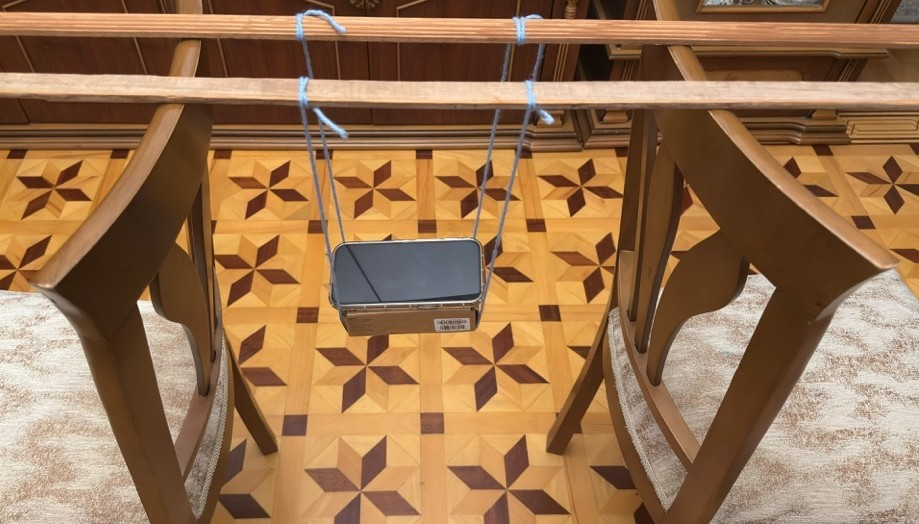

# Physics Pendulum Project: Measuring Gravity ($g$)

## 1. Question
Can we figure out the acceleration due to gravity ($g$) by timing a smartphone swinging on a string at different lengths?

---

## 2. Setup
* **App & Sensor:** I used the Phyphox app on my phone to record gyroscope data (angular velocity along the $X$ or $Y$ axis) while it swung back and forth.
* **Pendulum Construction:** I tied the smartphone to a cardboard box hanging from two parallel vertical strings attached between chairs and wooden rods[cite: 1]. 
* **Lengths Used:** I tested lengths from $0.20\text{ m}$ to $0.70\text{ m}$ specifically using **0.20 m, 0.30 m, 0.40 m, 0.50 m, and 0.70 m** (two runs for each). *(Note: I skipped 0.60 m because the recording got too noisy and the string slipped).*
* **How I Chose Time Cuts:** When I let go of the phone, my hand made the first few seconds messy and chaotic. I looked at the graphs to find where the clean wave started. For `L0.50`, I cut it at $10.2\text{ s}$, and for `L0.70`, at $17.5\text{ s}$ because they got messy earlier. For the other lengths, I just trimmed the first and last 2 seconds.

### Runs and Periods (Before vs. After Cutting)
| Length $L$ (m) | Run 1 Əvvəl | Run 2 Əvvəl | Run 1 Sonra | Run 2 Sonra |
| :--- | :--- | :--- | :--- | :--- |
| 0.20 | 0.878 s | 0.878 s | 0.879 s | 0.878 s |
| 0.30 | 1.186 s | 1.186 s | 1.187 s | 1.188 s |
| 0.40 | 1.294 s | 1.323 s | 1.307 s | 1.315 s |
| 0.50 | 1.262 s | 1.424 s | 1.417 s | 1.435 s |
| 0.70 | 1.500 s | 1.645 s | 1.638 s | 1.644 s |

---

### How My Analysis Changed (What Went Wrong & How I Fixed It)
1. I changed the peak detection `distance` setting from 0.4 s to 0.8 s so Python would stop counting fake double-peaks.
2. For `L0.50_run1`, the Z-axis data was messed up, so I switched to the Y-axis to get a clean 7 peaks instead of 14.
3. I fixed a mistake in my error formula calculation.
4. Cutting off the messy start and end parts of the recordings brought my calculated $g$ down from a crazy 12.55 to a much more realistic 10.76 $\text{m/s}^2$.

*(Note: The `check_offset.py` script was also used to check individual length differences compared to standard gravity $9.81 \text{ m/s}^2$).*

---

## 3. Data & Graph
I plotted $T^2$ against string length $L$. Since the formula is $T = 2\pi \sqrt{\frac{L}{g}}$, it turns into a straight line equation: $T^2 = \left(\frac{4\pi^2}{g}\right)L + c$.

*Note: Cleaned plots with peak markers for every run are saved in the `plots/` folder.*

---

## 4. Result
Using the slope ($m$) from my graph, I calculated gravity using $g = \frac{4\pi^2}{m}$:

* **Calculated Slope ($m$):** $3.669 \pm 0.198$
* **Intercept ($c$):** $0.1842$
* **Calculated Gravity ($g$):** $10.76 \pm 0.58 \text{ m/s}^2$
* **Standard Gravity:** $9.81 \text{ m/s}^2$

---

## 5. Why Not 9.81?
My calculated $g$ is $10.76 \text{ m/s}^2$, which is higher than the standard $9.81 \text{ m/s}^2$. Here is how each factor works and whether it can explain my result:

1. **Release Angle:** If you pull the phone back too far, the swing period gets longer ($T$ increases). The formula rearranged for gravity is $g = \frac{4\pi^2 L}{T^2}$, meaning a bigger $T$ actually **decreases** $g$. Since my $g$ is higher than 9.81, the release angle **cannot** explain it because it would push $g$ down, not up.
2. **Length Measurement (Constant Error):** If I measured every length a little bit short by the exact same amount (like missing 5 cm everywhere), it only shifts the intercept ($c$), **not the slope ($m$)**. Since $g$ depends entirely on the slope, a constant length error does **not** change $g$.
3. **The Intercept ($c$):** In an ideal pendulum, $c$ should be 0, but mine is `0.1842`. Dividing $c$ by the slope gives a length scale value that helps check how accurately I measured to the middle of the phone.
4. **Dual-String Suspension:** My phone hung from two parallel vertical strings rather than a single central line[cite: 1]. While this kept the setup stable, small variations in how the tension distributed or how length was measured down to the box's center of mass can slightly shift the effective length and affect our calculated $g$.
5. **Phone Twisting:** The phone twisted slightly while swinging. This didn't change the actual swing period, but it added noise to the sensor data and made it harder for Python to count peaks cleanly.
6. **Air Resistance:** Air resistance only slows down how wide the phone swings (it makes the amplitude smaller over time), but it **does not** change the time between swings (period). The distance between peaks stays the exact same.
7. **String Mass:** The string is super light compared to the heavy smartphone, so its mass is basically zero and doesn't affect the results at all.

---

## 6. What I'd Do Differently
* **Single-Point Clamp:** Use a single secure clamp or loop instead of a dual-string setup if we want a simpler ideal mathematical pendulum.
* **Better Release:** Make a simple trigger to let go of the phone smoothly without giving it an accidental twist.
* **Exact Center of Mass:** Use a more precise tool to find the exact center of the phone instead of guessing with a regular ruler.

---
* **AI Assistance Note:** AI helped me understand how peak detection works in Python, how to write the time-slicing logic (`t_max_limit`), and how to calculate the slope uncertainty.
