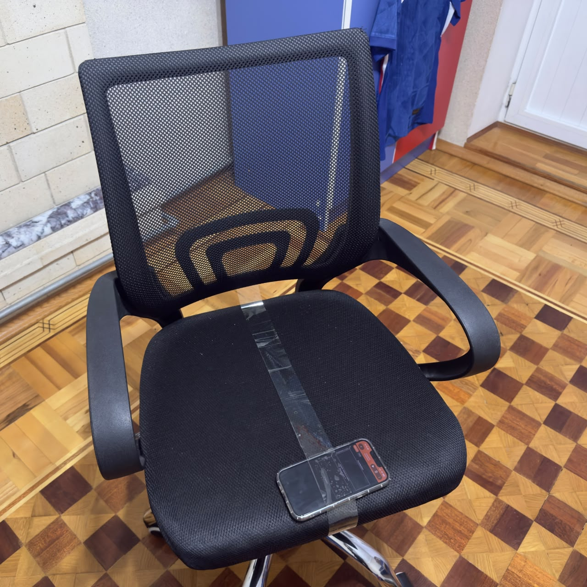
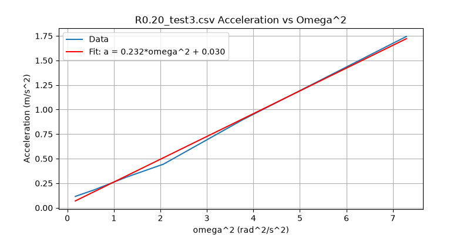
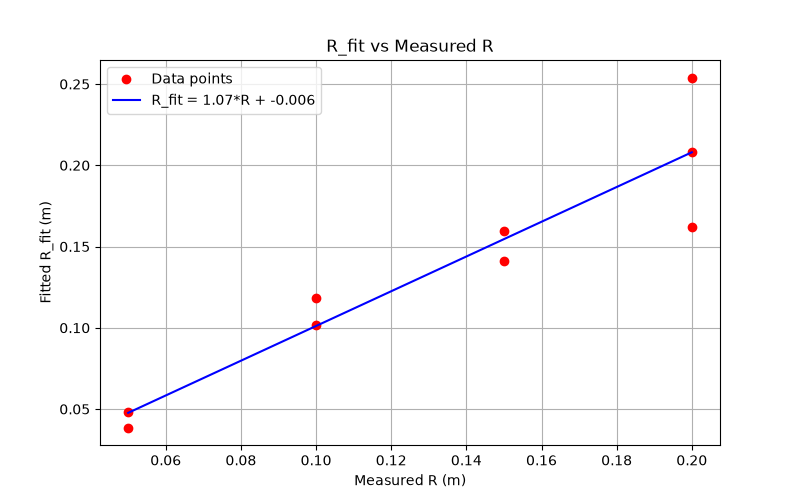

# Experiment 2: Centripetal Acceleration (a = ω²R)

## 1. Question

Can we check if the centripetal acceleration formula $a = \omega^2 R$ actually works by putting a phone on a spinning office chair at different distances?

---

## 2. Setup
- **App & Sensor:** I used the Phyphox app on my phone to record linear acceleration and gyroscope data while spinning the chair at different distances from the center.
- **Experimental Setup:** I laid the phone flat on the seat, lined it up straight with the radius, and spun the chair.
- **Radii Used:** I tested four different distances: 0.05, 0.10, 0.15, and 0.20 m (doing two runs for each, plus a couple of extra tests).
- **Chair Tilt:** Measured at -2° for $R = 0.05$ and $0.10\text{ m}$, and -3° for $R = 0.15$ and $0.20\text{ m}$.
- **How I Chose Time Cuts:** When pushing the chair by hand, my hand made the first few seconds too messy. I looked at the graphs to find where the push ended, cutting out the active pushing phase so I only looked at the clean coasting part.

### Summary of Runs & Data Files
| File Name | Measured Radius (m) | Chair Tilt | Notes & Observations |
| :--- | :--- | :--- | :--- |
| R0.05_test1.csv | 0.05 | -2° | Started third spin before chair fully stopped. |
| R0.05_test2.csv | 0.05 | -2° | More power given to all three spins. |
| R0.10_test1.csv | 0.10 | -2° | Clean run, everything went well. |
| R0.10_test2.csv | 0.10 | -2° | Clean run, everything went well. |
| R0.15_test1.csv | 0.15 | -3° | Clean run, everything went well. |
| R0.15_test2.csv | 0.15 | -3° | Started third spin before chair fully stopped. |
| R0.20_test.csv | 0.20 | -3° | *Discarded* (Only contained a single spin trial). |
| R0.20_test2.csv | 0.20 | -3° | Clean run, included some low-speed points ($\omega < 0.5\text{ rad/s}$). |
| R0.20_test3.csv | 0.20 | -3° | Additional clean test run added. |

---

### How My Analysis Changed (What Went Wrong & How I Fixed It)
1. I wrote `analyze.py` to go through the valid CSV files and cut out the manual push phase.
2. I noticed a big difference between the two $R = 0.20\text{ m}$ runs ($R_{\text{fit}}$ of $0.1295\text{ m}$ vs $0.2320\text{ m}$), which showed how much the fits depend on which time window you pick.
3. I checked my stopwatch times against the sensor peaks to see if they lined up. The stopwatch gives the average speed over 3 seconds, but the sensor catches the actual instantaneous peak speed, which explains why they didn't match up completely.

---

## 3. Data & Graph
I plotted the fitted radii ($R_{\text{fit}}$) against the measured radii ($R$). Since the relation is $R_{\text{fit}} = k \cdot R + d$, an ideal setup should give a slope of $k = 1$ and an intercept of $d = 0$.

*Linear acceleration vs $\omega^2$ fit plot for an individual test run.*

*Summary plot of fitted radius $R_{\text{fit}}$ vs measured radius $R$ across all valid runs.*

---

## 4. Result
After running a linear regression on all the valid runs, I got:

- **Calculated Slope (k):** $0.90 \pm 0.26$
- **Calculated Intercept (d):** $-0.014 \pm 0.035\text{ m}$
- **Expected Slope:** $1.0$

---

## 5. Why Not Exactly $k = 1, d = 0$?
My calculated slope is $0.90 \pm 0.26$ and intercept is $-0.014\text{ m}$. Both are close enough to the expected ideals ($k = 1, d = 0$) within error bounds, but here is what affected the results:

1. **Sensor Position:** The accelerometer chip inside the phone isn't right at the exact physical center where I measured with the ruler. However, because the error range ($\pm 0.035\text{ m}$) is bigger than $d$ ($-0.014\text{ m}$), our data can't prove a specific offset.
2. **Seat Tilt:** A slight chair tilt (-2° to -3°) makes gravity mix into the phone's acceleration readings, changing the vertical intercept $c$ in individual runs ($0.03\text{ to } 0.23\text{ m/s}^2$).
3. **Chair Slowing Down:** Friction makes the chair slow down, which creates a little bit of sideways (tangential) acceleration if the phone isn't aimed right at the center.
4. **Measuring R:** Using a ruler to measure from the middle of the chair to the phone has a tiny error (around $\pm 0.5\text{ cm}$), and that throws off the smaller radii way more than the bigger ones.
5. **Decay Dynamics:** Looking at the speed drops ($\omega_1/\omega_0 = 0.672$, $\omega_2/\omega_1 = 0.582$) shows it's just slowing down normally, though I didn't have enough data points to prove it's a pure exponential curve.

---

## 6. What I'd Do Differently
- **Higher Sampling Frequency:** Bump up the data rate in phyphox so I get more than just 3 to 7 data points in each slow-down window.
- **Secure Phone Clamp:** Use an actual clamp or mount so the phone doesn't slide around slightly on the seat.
- **Mark Rotation Axis:** Draw a clearer mark on the chair for the exact center so my ruler measurements are more accurate.
 
---
## AI note
- analyze.py: AI explained the script logic for looping through CSV files and filtering time windows.
- calculate_metrics.py: AI wrote the ratio checks and structured the error propagation.
- plot_script.py: AI helped with matplotlib layout and formatting options.
- notebook/log.md: I wrote it.
- README.md: AI helped format sections and structured the analysis writeup, I wrote the observations.
- BELEDCI-AZ.md: AI helped with the template, I wrote the content.