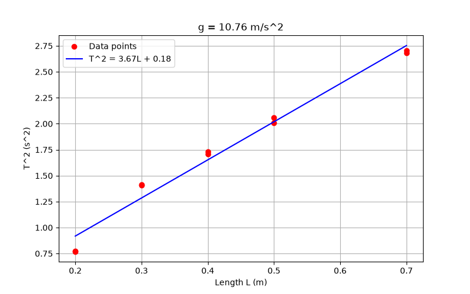

# Physics Pendulum Project: Measuring Gravity ($g$)

## 1. Question
Can we find the acceleration due to gravity ($g$) by timing a phone swinging on a string at different lengths?

---

## 2. Setup
- **App & Sensor:** I used the Phyphox app to measure gyroscope data (angular velocity along the $X$ or $Y$ axis) as the phone swung back and forth.
- **Pendulum Construction:** I tied a smartphone to a string hanging between two chairs and wooden rods. 
- **Length Measurement ($L$):** I measured lengths from the top pivot point down to the middle of the phone, from $0.20\text{m}$ to $0.70\text{m}$ (two runs for each length).
- **Data Cleaning & Time-Slicing:** A Python script (`analyze.py`) counted the peaks to find the period ($T$). The start and end of recordings were messy because my hand moved the string. To fix fake peaks, I cut off the noisy ends in Python. Most runs used a standard cut, but `L0.50` and `L0.70` needed custom cuts at $10.2\text{s}$ and $17.5\text{s}$ because they got chaotic earlier.

---

## 3. Data
I plotted $T^2$ against string length $L$. Since $T = 2\pi \sqrt{\frac{L}{g}}$, the formula rearranges to a straight line $T^2 = \left(\frac{4\pi^2}{g}\right)L + c$.

*Note: Cleaned plots with peak markers for each run are saved in the `plots/` folder.*

---

## 4. Result
Using the slope ($m$) from the line graph, I calculated gravity using $g = \frac{4\pi^2}{m}$:

- **Calculated Value:** $g = 10.76 \pm 0.58 \text{ m/s}^2$
- **Standard Value:** $9.81 \text{ m/s}^2$

---

## 5. Why Not 9.81?
My calculated gravity is $10.76 \text{ m/s}^2$, which is higher than the standard $9.81 \text{ m/s}^2$. Even with the error margin ($10.76 - 0.58 = 10.18$), it is still above $9.81$. Here is why:

1. **Length Measurement:** It was hard to find the exact center of mass of the phone with a ruler. If I measured the string a bit shorter than it actually was, the math makes $g$ look bigger.
2. **Phone Twisting:** The phone wobbled and twisted slightly instead of swinging in a perfectly straight line. This extra rotational movement messed with the period timing.
3. **Release Angle:** If I pulled the phone back too far at the start, the swing period gets slightly longer, which changes the slope and pushes $g$ up.

---

## 6. What I'd Do Differently
- **Better Clamp:** Use a solid metal clamp instead of tying a string over wooden sticks to stop the string from slipping or twisting.
- **Better Release:** Make a simple trigger to drop the phone smoothly without giving it any accidental twist.
- **Exact Length Measurement:** Use a caliper or laser tape to get a much more accurate length measurement to the center of the phone.

---
*Note: AI helped me understand how peak detection works in Python, how to calculate slope uncertainty, and how to spot twisting noise in sensor data.*